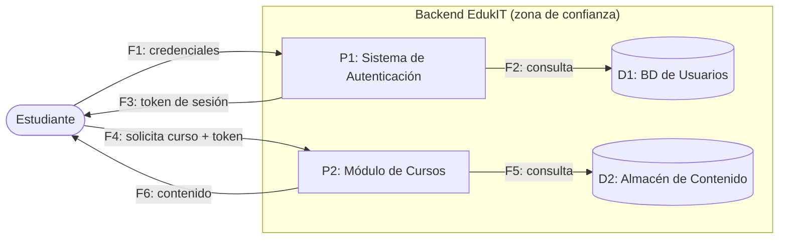
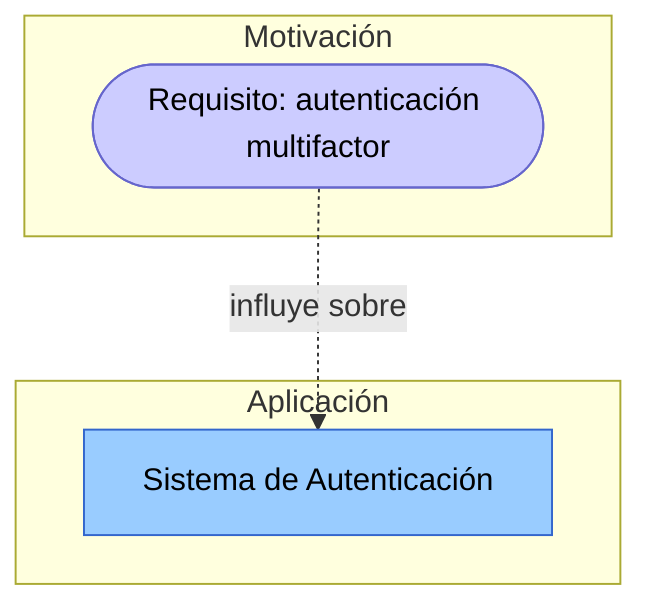

# Guía Paso a Paso: Evaluación de Seguridad con STRIDE

Esta guía complementa el `README.md` del taller. Su objetivo es que, antes de analizar un flujo crítico de EdukIT en clase (Parte 1) o del sistema del cliente real (Parte 2), el equipo tenga una referencia clara del marco STRIDE y de la metodología para pasar de "dibujar el flujo" a "priorizar amenazas reales".

El diagrama de ejemplo de esta guía está escrito en [Mermaid](https://mermaid.js.org/) y se renderiza automáticamente al ver este archivo en GitHub.

---

## 1. Las 6 categorías de STRIDE

| Categoría | Pregunta guía | Ejemplo típico |
|---|---|---|
| **S**poofing (Suplantación) | ¿Alguien puede hacerse pasar por otro usuario o sistema? | Credenciales robadas, phishing |
| **T**ampering (Alteración) | ¿Alguien puede modificar datos o mensajes sin autorización? | Interceptar y modificar un token en tránsito |
| **R**epudiation (Repudio) | ¿Alguien puede negar haber realizado una acción? | Falta de logs de auditoría |
| **I**nformation Disclosure (Divulgación) | ¿Puede exponerse información que debería ser privada? | Consulta sin control de acceso, backup expuesto |
| **D**enial of Service (Denegación de servicio) | ¿Puede alguien dejar el sistema o un componente inaccesible? | Saturación de solicitudes |
| **E**levation of Privilege (Elevación de privilegios) | ¿Puede alguien obtener permisos mayores a los que le corresponden? | Manipular el rol en una solicitud |

---

## 2. Metodología en 5 pasos

STRIDE no se aplica "en el aire": se aplica sobre un diagrama de flujo de datos (DFD) del proceso. Sin ese diagrama, las amenazas terminan siendo genéricas.

1. **Elegir el flujo y dibujar su DFD** — represente el flujo crítico como actores externos, procesos, almacenes de datos y los flujos entre ellos, marcando el límite de confianza (qué está dentro y qué está fuera del control del sistema).
2. **Identificar los elementos a analizar** — liste cada proceso, almacén de datos y flujo del DFD; cada uno es candidato a amenazas.
3. **Aplicar las 6 categorías STRIDE** — para cada elemento relevante, formule la amenaza concreta en cada categoría que aplique (no todas las categorías aplican a todos los elementos).
4. **Evaluar impacto y proponer mitigación** — para cada amenaza identificada, describa su impacto y un control concreto que la mitigue.
5. **Priorizar por riesgo** — combine impacto y probabilidad para asignar un nivel de riesgo a cada amenaza y ordene la tabla de mayor a menor riesgo.

> **Límites de confianza y Zero Trust.** El modelo antiguo asumía que lo que estaba dentro de la red era confiable; Zero Trust (NIST SP 800-207) elimina ese supuesto: cada petición se verifica venga de donde venga, con identidad propia y verificable para personas, servicios y agentes automatizados, mínimo privilegio, credenciales de vida corta y verificación continua. Al dibujar el DFD del cliente real no trace un único límite «dentro / fuera»: toda flecha que cruza un límite de confianza es un punto de análisis obligatorio. Pregunta para el cliente: ¿cuántas cuentas de servicio tiene el sistema, quién las creó, qué permisos tienen y cuándo se rotaron sus credenciales por última vez? En la mayoría de las organizaciones nadie sabe responder, y esa es exactamente la brecha.
>
> **Herramienta.** draw.io basta para el DFD (puede partir del C2 del Taller 3 con los límites de confianza dibujados encima). [OWASP Threat Dragon](https://owasp.org/www-project-threat-dragon/) (gratuita, web y escritorio) es opcional: dibuja el DFD y permite anotar las amenazas sobre cada elemento. La herramienta no se califica; se califica que la tabla tenga las seis categorías y que cada control sea verificable.

---

## 3. Ejemplo guiado: Acceso de estudiantes a cursos y materiales (EdukIT)

### Paso 1 — Elegir el flujo y dibujar su DFD

Se elige el flujo de **acceso de estudiantes a cursos y materiales**: el estudiante se autentica y luego solicita el contenido de un curso. Se marca el límite de confianza entre el estudiante (fuera del control de EdukIT) y el backend (dentro).



### Paso 2 — Identificar los elementos a analizar

| ID | Elemento | Tipo |
|---|---|---|
| E1 | Estudiante | Actor externo |
| P1 | Sistema de Autenticación | Proceso |
| P2 | Módulo de Cursos | Proceso |
| D1 | BD de Usuarios | Almacén de datos |
| D2 | Almacén de Contenido | Almacén de datos |
| F1–F6 | Flujos de datos entre los anteriores | Flujo |

### Paso 3 — Aplicar las 6 categorías STRIDE

Se formula una amenaza concreta por categoría, señalando el elemento exacto sobre el que ocurre y qué control ya existe hoy frente a ella (todavía sin impacto ni mitigación — eso se agrega en el Paso 4):

| ID | Componente / Activo | Tipo STRIDE | Descripción de la Amenaza | Escenario de Ataque | Controles de Seguridad Existentes |
|---|---|---|---|---|---|
| T1 | Sistema de Autenticación (P1) / Credenciales (F1) | Spoofing | Un atacante se hace pasar por un estudiante usando credenciales robadas o phishing. | Atacante usa credenciales robadas vía phishing para iniciar sesión. | Autenticación con usuario y contraseña, sin MFA. |
| T2 | Token de sesión (F3) | Tampering | El token de sesión es interceptado y modificado en tránsito si la comunicación no usa TLS. | Atacante intercepta la comunicación en una red no segura (ej. WiFi público) y modifica el token antes de que llegue al servidor. | Comunicación cifrada con HTTPS en el flujo principal, sin verificación de firma del token en cada solicitud. |
| T3 | Sistema de Autenticación (P1) — registro de acciones | Repudiation | Un estudiante o administrador realiza una acción sensible (ej. cambia una nota) y luego niega haberlo hecho, por falta de registro de auditoría. | Un docente cambia una calificación desde el panel y luego niega la acción al no existir registro con marca de tiempo y usuario. | Registro de accesos básico, sin logs de auditoría con marca de tiempo y usuario para acciones sensibles. |
| T4 | BD de Usuarios (D1) | Information Disclosure | Exposición de datos personales o notas académicas por una consulta sin control de acceso adecuado. | Atacante explota un endpoint de consulta sin validar permisos y descarga el historial académico de otros estudiantes. | Control de acceso a nivel de aplicación, sin validación de permisos a nivel de consulta a la BD. |
| T5 | Módulo de Cursos (P2) | Denial of Service | Un atacante satura las solicitudes de contenido y deja el módulo de cursos inaccesible durante un examen. | Atacante lanza un ataque de flooding contra el endpoint de contenido de cursos durante la semana de exámenes. | Balanceador de carga básico, sin límite de tasa (rate limiting) configurado. |
| T6 | Solicitud de curso con rol (F4) | Elevation of Privilege | Un estudiante manipula el parámetro de rol en la solicitud para acceder a funciones de docente o administrador. | Estudiante modifica manualmente el campo `role` en el payload de la solicitud para obtener acceso de administrador. | Validación de rol en el cliente (frontend), sin revalidación estricta en el servidor. |

### Paso 4 — Evaluar impacto y proponer mitigación

Se completan las columnas restantes de la plantilla oficial (impacto, probabilidad, nivel de riesgo, mitigación, responsable y estado), llegando así a la tabla combinada final con las 12 columnas de `plantilla_analisis_stride.xlsx` — esta es la tabla que se entrega como `tabla-stride-clase.xlsx`:

| ID | Componente / Activo | Tipo STRIDE | Descripción de la Amenaza | Escenario de Ataque | Impacto | Probabilidad | Nivel de Riesgo | Controles de Seguridad Existentes | Mitigación Recomendada | Responsable | Estado |
|---|---|---|---|---|---|---|---|---|---|---|---|
| T1 | Sistema de Autenticación (P1) / Credenciales (F1) | Spoofing | Un atacante se hace pasar por un estudiante usando credenciales robadas o phishing. | Atacante usa credenciales robadas vía phishing para iniciar sesión. | Alto — acceso no autorizado a la cuenta y sus datos | Media | **Alto** | Autenticación con usuario y contraseña, sin MFA. | Autenticación multifactor (MFA) y bloqueo tras intentos fallidos | Equipo de Seguridad | Pendiente |
| T2 | Token de sesión (F3) | Tampering | El token de sesión es interceptado y modificado en tránsito si la comunicación no usa TLS. | Atacante intercepta la comunicación en una red no segura (ej. WiFi público) y modifica el token antes de que llegue al servidor. | Alto — secuestro de sesión activa | Baja | Medio | Comunicación cifrada con HTTPS en el flujo principal, sin verificación de firma del token en cada solicitud. | Forzar HTTPS/TLS en todas las comunicaciones y firmar/verificar el token (JWT) | Equipo Backend | En análisis |
| T3 | Sistema de Autenticación (P1) — registro de acciones | Repudiation | Un estudiante o administrador realiza una acción sensible (ej. cambia una nota) y luego niega haberlo hecho, por falta de registro de auditoría. | Un docente cambia una calificación desde el panel y luego niega la acción al no existir registro con marca de tiempo y usuario. | Medio — dificulta resolver disputas académicas | Media | Medio | Registro de accesos básico, sin logs de auditoría con marca de tiempo y usuario para acciones sensibles. | Registro de auditoría (logs) con marca de tiempo y usuario para acciones sensibles | DevOps | Pendiente |
| T4 | BD de Usuarios (D1) | Information Disclosure | Exposición de datos personales o notas académicas por una consulta sin control de acceso adecuado. | Atacante explota un endpoint de consulta sin validar permisos y descarga el historial académico de otros estudiantes. | Alto — incumplimiento de protección de datos (Ley 1581) | Media | **Alto** | Control de acceso a nivel de aplicación, sin validación de permisos a nivel de consulta a la BD. | Cifrado en reposo y control de acceso basado en roles (RBAC) a nivel de consulta | Equipo de Arquitectura | En progreso |
| T5 | Módulo de Cursos (P2) | Denial of Service | Un atacante satura las solicitudes de contenido y deja el módulo de cursos inaccesible durante un examen. | Atacante lanza un ataque de flooding contra el endpoint de contenido de cursos durante la semana de exámenes. | Medio — interrupción temporal del servicio | Baja | Bajo | Balanceador de carga básico, sin límite de tasa (rate limiting) configurado. | Límite de tasa (rate limiting) y auto-escalado con balanceo de carga | Infraestructura | Pendiente |
| T6 | Solicitud de curso con rol (F4) | Elevation of Privilege | Un estudiante manipula el parámetro de rol en la solicitud para acceder a funciones de docente o administrador. | Estudiante modifica manualmente el campo `role` en el payload de la solicitud para obtener acceso de administrador. | Alto — control total sobre contenido o calificaciones ajenas | Baja | Medio | Validación de rol en el cliente (frontend), sin revalidación estricta en el servidor. | Validar el rol en el servidor en cada solicitud; nunca confiar en el rol enviado por el cliente | Equipo de Seguridad | En análisis |

### Paso 5 — Priorizar por riesgo

A partir de la tabla completa del Paso 4, se construye una vista priorizada: se ordenan los ID por `Nivel de Riesgo` de mayor a menor. El detalle completo (impacto, probabilidad, controles existentes, mitigación, responsable y estado) permanece en la tabla del Paso 4; aquí solo se resume lo necesario para decidir qué atender primero.

| Prioridad | ID | Tipo STRIDE | Componente / Activo | Nivel de Riesgo |
|---|---|---|---|---|
| 1 | T4 | Information Disclosure | BD de Usuarios (D1) | **Alto** |
| 2 | T1 | Spoofing | Sistema de Autenticación (P1) / Credenciales (F1) | **Alto** |
| 3 | T6 | Elevation of Privilege | Solicitud de curso con rol (F4) | Medio |
| 4 | T2 | Tampering | Token de sesión (F3) | Medio |
| 5 | T3 | Repudiation | Sistema de Autenticación (P1) — registro de acciones | Medio |
| 6 | T5 | Denial of Service | Módulo de Cursos (P2) | Bajo |

---

## 4. Práctica guiada: laboratorio con OWASP Juice Shop

Hasta aquí STRIDE se trabajó sobre el papel. Esta práctica es opcional pero muy recomendada en la sesión de clase: se hace lo mismo, pero **ejecutando el ataque de verdad** contra una aplicación construida a propósito para esto, para que la amenaza deje de ser un párrafo abstracto.

Los 6 mecanismos y los 4 retos de esta sección están diagramados de forma interactiva en [`clase/modelado-de-amenazas.html`](modelado-de-amenazas.html) — útil para presentar en clase antes de que cada equipo entre a Juice Shop.

**[OWASP Juice Shop](https://owasp.org/www-project-juice-shop/)** es una tienda en línea deliberadamente vulnerable, publicada por OWASP específicamente para entrenamiento de seguridad — no es un sistema real, no hay implicaciones legales ni éticas por atacarla en su propia máquina.

**Cómo levantarla (elija una opción):**
- Docker (recomendado): `docker run --rm -p 3000:3000 bkimminich/juice-shop`, luego abra `http://localhost:3000`.
- O use la [demo pública oficial](https://juice-shop.herokuapp.com/) si no puede instalar Docker (más lenta, compartida con otros usuarios).

**4 retos guiados, uno por categoría STRIDE ya vista en el ejemplo de EdukIT:**

| # | Categoría | Reto | Cómo hacerlo |
|---|---|---|---|
| 1 | Spoofing | Iniciar sesión como administrador sin conocer su contraseña | En el campo de correo del login, escriba `' OR 1=1--` y cualquier contraseña. Esto es una inyección SQL clásica: el `OR 1=1` hace que la consulta de validación sea siempre verdadera. |
| 2 | Tampering | Comprar un producto pagando menos de su precio real | Agregue un producto al carrito, abra las herramientas de desarrollador del navegador (pestaña Red/Network), y modifique el valor `price` en la solicitud antes de confirmar la compra. |
| 3 | Information Disclosure | Ver el carrito de compras de otro usuario | Inicie sesión, agregue un producto, y cambie el ID del carrito en la URL o en la solicitud a la API (ej. de `/rest/basket/6` a `/rest/basket/1`) para ver si el servidor valida que el carrito pertenezca a su usuario. |
| 4 | Elevation of Privilege | Acceder al panel de administración sin ser administrador | Inicie sesión como usuario normal y navegue directamente a `http://localhost:3000/#/administration` — revise si el sistema realmente valida el rol en el servidor o solo oculta el enlace en la interfaz. |

**Qué anotar de cada reto** (esto se integra directamente en la tabla del Paso 3-4 de la sección anterior, como una fila más basada en evidencia real en vez de un escenario hipotético):

| Reto | Categoría STRIDE | ¿Qué control faltaba? | Mitigación real que lo hubiera evitado |
|---|---|---|---|
| 1 — Login bypass | Spoofing | Sin *prepared statements* / sin validación del input | Usar consultas parametrizadas (nunca concatenar el input del usuario en SQL) |
| 2 — Precio manipulado | Tampering | El servidor confía en el precio que envía el cliente | Recalcular el precio en el servidor a partir del catálogo, nunca aceptar el precio del request |
| 3 — Carrito ajeno | Information Disclosure | Falta de validación de propiedad del recurso (IDOR) | Verificar en el servidor que el recurso solicitado pertenece al usuario autenticado |
| 4 — Panel admin | Elevation of Privilege | Control de acceso solo en el frontend | Revalidar el rol en cada endpoint del backend, nunca confiar en la interfaz |

> **Estos retos son solo para Juice Shop, en su propia máquina.** Nunca repita estas técnicas (inyección SQL, manipulación de solicitudes, acceso a rutas de administración) contra el sistema del cliente real ni contra cualquier sistema en producción sin autorización explícita por escrito — eso deja de ser un ejercicio de clase y se convierte en una prueba de penetración real, con implicaciones legales.

---

## 5. Reconocimiento pasivo autorizado (para el cliente real)

En la Parte 2, en vez de que la columna "Controles de Seguridad Existentes" sea una suposición, complétela con evidencia real observable **desde afuera**, sin necesidad de credenciales ni de tocar nada del lado del cliente. Esto es reconocimiento **pasivo y de solo lectura** — nunca un intento de explotación.

| Qué revisar | Cómo (herramienta gratuita) | Qué categoría STRIDE alimenta |
|---|---|---|
| Cabeceras de seguridad HTTP (HSTS, CSP, X-Frame-Options) | `curl -I https://sitio-del-cliente.com` o [securityheaders.com](https://securityheaders.com) | Tampering, Information Disclosure |
| Configuración TLS/certificado | [ssllabs.com/ssltest](https://www.ssllabs.com/ssltest/) | Tampering, Spoofing |
| Mensajes de error expuestos (stack traces, versiones de software) | Provocar un error simple (ej. una URL inválida) y observar la respuesta | Information Disclosure |
| Documentación de API pública sin autenticación (ej. Swagger/OpenAPI abierto) | Buscar rutas comunes como `/swagger`, `/api-docs` | Information Disclosure, Elevation of Privilege |
| Filtraciones de datos pasadas asociadas al dominio | [haveibeenpwned.com](https://haveibeenpwned.com/) | Information Disclosure |

> **Límite estricto:** esto se queda en observación pasiva de lo que el sistema ya expone públicamente. No se envían credenciales de prueba, no se intentan inyecciones, no se accede a rutas privadas ni se prueban contraseñas — nada que requiera autorización. Si el equipo o el cliente quieren ir más allá (pruebas activas), eso es un pentest formal con alcance y autorización por escrito, fuera del alcance de este taller.

---

## 6. Errores comunes a evitar

| Error frecuente | Por qué es un problema | Cómo corregirlo |
|---|---|---|
| Amenazas genéricas ("puede haber un hackeo") | No es accionable ni evaluable: no dice qué elemento ni cómo | Formule la amenaza sobre un elemento específico del DFD (ej. "el flujo F1 puede ser interceptado...") |
| Aplicar solo 2–3 categorías y omitir el resto | El marco pierde su propósito: cubrir sistemáticamente los 6 tipos de riesgo | Revise las 6 categorías para cada elemento relevante, aunque alguna no aplique |
| Mitigación vaga ("mejorar la seguridad") | No es una acción verificable ni evaluable en la rúbrica | Proponga un control concreto (MFA, cifrado, rate limiting, RBAC, logs de auditoría, etc.) |
| No priorizar los hallazgos | Un informe con muchas amenazas sin orden no ayuda a decidir qué atender primero | Clasifique cada amenaza por impacto × probabilidad y priorice (Paso 5) |
| Hacer pruebas activas (inyección, fuerza bruta, acceso no autorizado) contra el sistema del cliente real | Sin autorización por escrito, es una prueba de penetración no autorizada, con implicaciones legales | Los retos activos se practican solo en Juice Shop (sección 4); con el cliente real, solo reconocimiento pasivo (sección 5) |

---

## 7. Checklist de autoevaluación antes de entregar

- [ ] Se documentó el DFD del flujo analizado (para el cliente real, en `entrega/dfd-cliente.drawio`), con procesos, almacenes de datos, flujos y límites de confianza.
- [ ] Se aplicaron las 6 categorías STRIDE sobre los elementos relevantes del flujo.
- [ ] Cada amenaza está redactada sobre un elemento específico, no de forma genérica.
- [ ] Cada amenaza tiene una mitigación concreta y verificable.
- [ ] Cada amenaza tiene impacto, probabilidad y nivel de riesgo asignado.
- [ ] Los hallazgos están priorizados de mayor a menor riesgo.
- [ ] Se completó al menos un reto práctico en Juice Shop y se relacionó con una fila de la tabla STRIDE.
- [ ] La columna "Controles de Seguridad Existentes" del cliente real se basa en reconocimiento pasivo real (sección 5), no en suposiciones.
- [ ] Ninguna técnica activa (inyección, manipulación de solicitudes, acceso no autorizado) se probó contra el sistema del cliente real sin autorización explícita por escrito.

---

## 8. Vista ArchiMate equivalente

STRIDE no tiene una capa propia en ArchiMate — sus mitigaciones se modelan como **Requirement** en la capa de Motivación (ver la [Guía de Notación ArchiMate](https://github.com/CesarAVegaF312/AREM-ArchiMate/blob/main/guia_notacion_archimate.md)), conectados con **Influence** al elemento de Aplicación o Tecnología que deben proteger.



Cada fila de la tabla completa (Paso 4) es candidata a convertirse en un `Requirement`: la columna "Mitigación Recomendada" es el texto del requisito, y las columnas "Tipo STRIDE" / "Componente / Activo" indican sobre qué componente de Aplicación o Tecnología aplica la relación **Influence**.

---

## 9. Validación técnica: escaneo automatizado del laboratorio (opcional)

En la sección 4 el equipo encontró amenazas a mano, pensando como atacante. Esta sección agrega la otra mitad: lo que una herramienta automática encuentra sola sobre la misma aplicación, y lo que **no** encuentra. No es un ejercicio de programación: el laboratorio ya está listo en [`validacion-tecnica/`](validacion-tecnica/) y cada escaneo es un comando.

### 9.1 Qué se necesita

- [Docker Desktop](https://www.docker.com/products/docker-desktop/) (o Docker Engine en Linux).
- Descargar las imágenes **antes de la clase**: la de ZAP pesa cerca de 3,5 GB. Desde `clase/validacion-tecnica/`: `docker compose --profile escaneo pull`.

### 9.2 Correr los escaneos

Desde la carpeta `clase/validacion-tecnica/`:

```bash
docker compose up -d juice-shop     # la misma Juice Shop de la sección 4, en http://localhost:3000
docker compose run --rm zap         # unos 2 minutos
docker compose run --rm trivy       # la primera vez descarga la base de vulnerabilidades
docker compose down
```

Los reportes quedan en `clase/validacion-tecnica/reportes/`:

| Herramienta | Qué revisa | Reporte |
|---|---|---|
| [OWASP ZAP](https://www.zaproxy.org/) (escaneo base) | Recorre el sitio y revisa las respuestas HTTP: encabezados de seguridad, cookies, información expuesta. No envía ataques. | `reporte-zap.html` (se abre en el navegador) |
| [Trivy](https://trivy.dev/) | Compara los componentes instalados en la imagen (sistema operativo y librerías) contra bases públicas de vulnerabilidades conocidas (CVE). Se limita a severidad alta y crítica. | `reporte-trivy.txt` |

### 9.3 De la alerta a la tabla STRIDE

Una alerta no es una amenaza: hay que decidir qué elemento afecta, en qué categoría cae y si de verdad importa. Estas son las alertas que reporta ZAP sobre Juice Shop:

| Alerta de ZAP | Qué significa | Categoría STRIDE | ¿Riesgo real? |
|---|---|---|---|
| Content Security Policy (CSP) Header Not Set | El navegador no tiene reglas sobre qué scripts puede ejecutar, lo que facilita inyectar código en la página | Tampering | Sí |
| Cross-Domain Misconfiguration | La aplicación permite que cualquier otro sitio web lea sus respuestas (CORS abierto) | Information Disclosure | Depende de qué datos exponga cada respuesta |
| Cross-Domain JavaScript Source File Inclusion | La página carga scripts de servidores de terceros; si ese tercero es comprometido, el script también | Tampering | Depende del tercero |
| Information Disclosure - Suspicious Comments | El código que llega al navegador tiene comentarios con palabras como "TODO" o "admin" | Information Disclosure | Hay que revisarlo a mano |
| Timestamp Disclosure - Unix | Aparecen números que parecen fechas | Information Disclosure | Casi siempre un falso positivo |
| Modern Web Application | Solo informa que el sitio es una aplicación de una sola página | Ninguna | No, es informativa |

Trivy, por su parte, reporta cientos de vulnerabilidades altas y críticas en librerías desactualizadas (Juice Shop está desactualizada a propósito). Esas filas alimentan la columna **Controles de Seguridad Existentes** ("no hay un proceso de actualización de dependencias") y suelen caer en Denial of Service o Elevation of Privilege según la descripción de cada CVE.

**Lo más importante es lo que no aparece.** Ninguno de los dos escaneos detecta los cuatro retos de la sección 4: ni el inicio de sesión con inyección SQL, ni el precio manipulado, ni el carrito ajeno, ni el panel de administración. Son fallas de lógica del negocio y de control de acceso, y solo se encuentran pensando cada flujo del DFD con STRIDE. Un reporte de escaneo limpio no significa un sistema seguro.

### 9.4 Qué entregar

En `entrega/informe.md`, agregue una sección corta con:

1. Dos alertas de ZAP llevadas a la tabla STRIDE (con elemento afectado, categoría y si es riesgo real o falso positivo).
2. Una conclusión de Trivy sobre la gestión de dependencias.
3. Una comparación: qué encontró el escaneo, qué encontró el análisis manual, y qué encontraron los dos.

> **Estos escaneos se hacen solo contra el laboratorio, en su propio computador.** El escaneo base de ZAP recorre todas las páginas del sitio y genera cientos de solicitudes: contra el sistema del cliente real o cualquier sistema de terceros, eso ya no es reconocimiento pasivo (sección 5) y requiere autorización por escrito.

---

## 10. Análisis de caso real y panorama tecnológico (opcional)

### 10.1 Caso: la filtración de datos de Equifax (Estados Unidos, 2017)

**Qué pasó.** Equifax, una de las agencias de información crediticia más grandes de Estados Unidos, usaba Apache Struts, una librería de código abierto, en su portal web de reclamaciones. En marzo de 2017 se publicó una vulnerabilidad crítica en Struts (CVE-2017-5638) junto con su corrección. Equifax no actualizó el portal. Desde mediados de mayo de 2017, los atacantes explotaron esa vulnerabilidad, entraron a la red y, durante 76 días, hicieron unas 9.000 consultas a 51 bases de datos. Equifax detectó el acceso en julio y lo anunció en septiembre de 2017. Se expusieron datos personales de al menos 145,5 millones de personas.

La Oficina de Rendición de Cuentas del Gobierno de Estados Unidos (GAO) concluyó que la vulnerabilidad sin corregir fue solo una de varias fallas: la lista de administradores que debía recibir el aviso de actualización estaba desactualizada, y un certificado digital vencido en un equipo de monitoreo impidió detectar a tiempo la salida de los datos.

**Qué falló, en STRIDE.**

| Elemento | Categoría STRIDE | Qué falló |
|---|---|---|
| Portal de reclamaciones (proceso expuesto a internet) | Elevation of Privilege | Una librería con vulnerabilidad conocida permitió ejecutar comandos en el servidor |
| Bases de datos con información personal (almacenes de datos) | Information Disclosure | Una vez dentro, los atacantes pudieron consultar 51 bases de datos sin restricción |
| Monitoreo del tráfico de salida | Repudiation | Con el certificado vencido, el equipo de monitoreo no inspeccionaba ese tráfico y la salida de datos pasó desapercibida durante meses |

**Relación con la validación técnica.** Es exactamente lo que encuentra Trivy en la sección 9: componentes con vulnerabilidades conocidas y una versión corregida disponible. Pero el caso muestra que tener la herramienta no basta: el aviso existía y no llegó a quien debía actuar. El control que falló fue el proceso, no la tecnología.

**Preguntas para el análisis.**

1. Dibuje el DFD del flujo "un consumidor presenta una reclamación" y marque el límite de confianza que los atacantes cruzaron.
2. Si Equifax hubiera corrido un escaneo como el de Trivy cada semana, ¿quién debía recibir el reporte y en cuánto tiempo debía actuar? Escríbalo como una mitigación de la tabla STRIDE (con responsable y estado).
3. ¿Por qué un atacante dentro del portal pudo llegar a 51 bases de datos? ¿Qué control de segmentación o de mínimo privilegio lo habría limitado?

**Fuentes.** [GAO-18-559, "Data Protection: Actions Taken by Equifax and Federal Agencies in Response to the 2017 Breach" (agosto de 2018)](https://www.gao.gov/products/gao-18-559); [CSO Online, "Equifax data breach FAQ"](https://www.csoonline.com/article/567833/equifax-data-breach-faq-what-happened-who-was-affected-what-was-the-impact.html).

### 10.2 Panorama tecnológico

Cada tipo de herramienta mira el sistema desde un ángulo distinto, y ninguna cubre las seis categorías STRIDE por sí sola.

| Tipo | Qué revisa | Ejemplos | Categorías STRIDE que más apoya |
|---|---|---|---|
| SAST (análisis estático) | El código fuente, sin ejecutarlo | Semgrep, SonarQube, CodeQL | Tampering, Elevation of Privilege (errores de validación en el código) |
| DAST (análisis dinámico) | La aplicación en ejecución, desde afuera | OWASP ZAP, Burp Suite | Information Disclosure, Tampering (lo que se ve en la sección 9) |
| SCA (análisis de componentes) | Las librerías y dependencias, contra bases de CVE | Trivy, OWASP Dependency-Check, Dependabot | Todas, según la vulnerabilidad (caso Equifax) |
| Detección de secretos | Contraseñas y llaves olvidadas en el código | Gitleaks, escaneo de secretos de GitHub | Spoofing, Information Disclosure |
| Firewall de aplicaciones web (WAF) | El tráfico que llega a la aplicación, en tiempo real | ModSecurity con OWASP Core Rule Set, Cloudflare WAF, AWS WAF | Tampering, Denial of Service |
| Gestión de identidad | Autenticación y autorización centralizadas | Keycloak, Microsoft Entra ID, Auth0 | Spoofing, Elevation of Privilege |
| Registro y monitoreo de seguridad (SIEM) | Los eventos de todos los componentes, para detectar y reconstruir incidentes | Wazuh, Elastic Security, Microsoft Sentinel | Repudiation (caso Equifax: la salida de datos no se detectó) |

### 10.3 Aplicarlo al cliente real

1. Busque un caso público y documentado de incidente de seguridad en el sector del cliente. En Colombia, los reportes del ColCERT y las decisiones de la Superintendencia de Industria y Comercio sobre protección de datos personales son buenas fuentes.
2. Analícelo con la [plantilla de análisis de caso](../plantillas/plantilla_analisis_caso.md) y guárdelo en `entrega/analisis-caso.md`.
3. En la sección 5 de la plantilla, compare dos tecnologías del panorama anterior para la amenaza de mayor riesgo de su tabla STRIDE.

---

_Esta guía hace parte del Taller 5 de Evaluación de Seguridad con STRIDE — curso Arquitectura Empresarial, Universidad de La Sabana._
